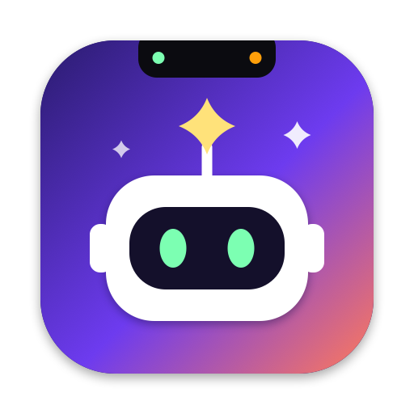
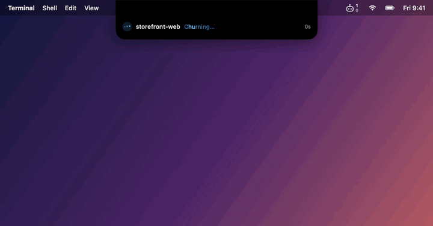
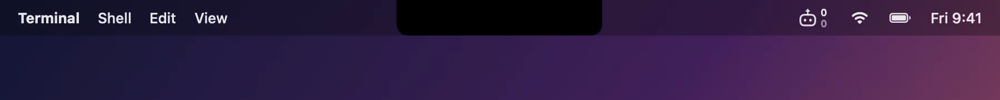
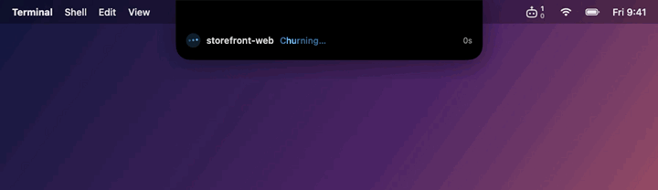
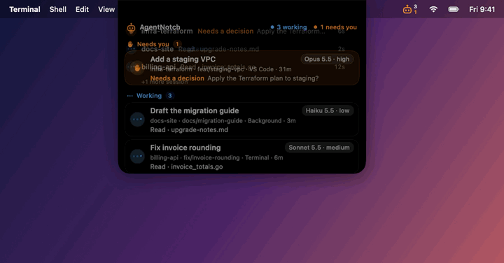
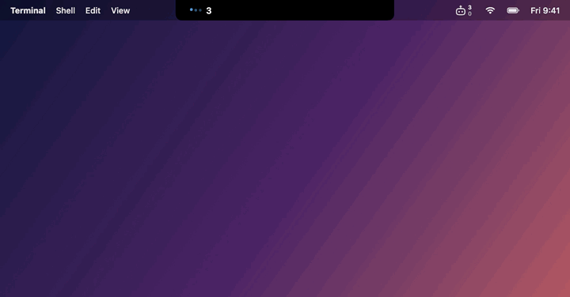
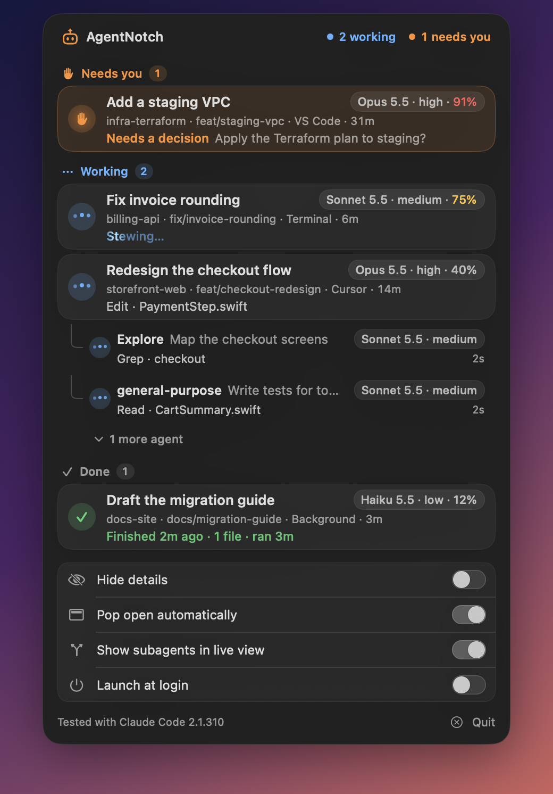
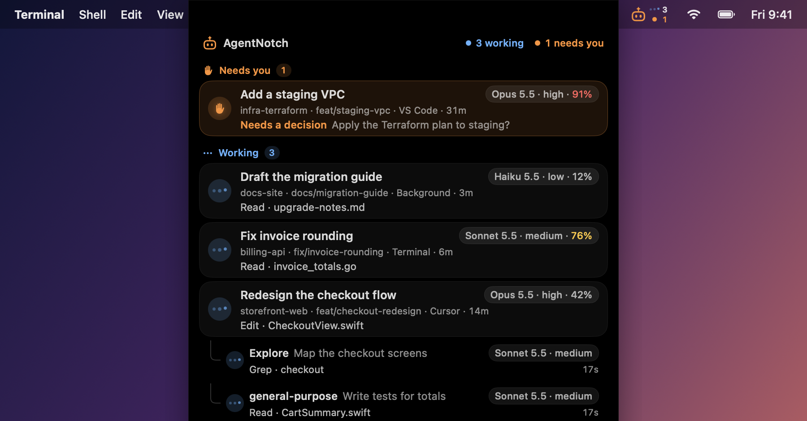
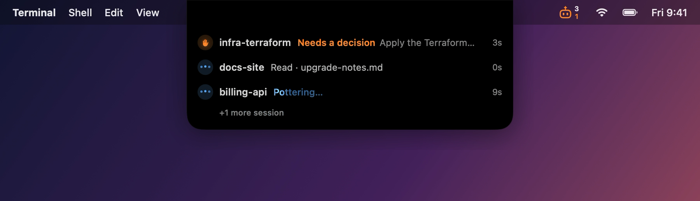
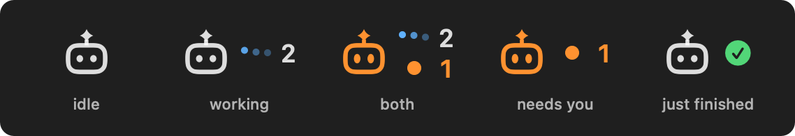

<!-- Classification: PUBLIC -->
<p align="center"></p>

# AgentNotch

See every running Claude Code session on your Mac at a glance: in the notch and in the menu bar.

If you run several Claude Code sessions at once (Terminal, the Cursor or VS Code extension,
`claude --bg`), AgentNotch shows which ones are working, which are waiting for you, and what each
is doing right now. Click a row to jump to it. It is strictly **read-only**: it never approves,
sends, stops or resumes anything, installs no hooks, and makes no network calls.

> AgentNotch is an independent community project. It is not affiliated with or endorsed by Anthropic.

<p align="center"></p>

## Preview

All media below is a scripted run on synthetic sessions (`AgentNotch --demo`), not real work.

| | |
|---|---|
| **Collapsed.** While anything runs, the notch grows a side on each edge: working count on the left, sessions that need you on the right. <br> | **Live strip.** The notch opens on its own when a session starts working or needs you. <br> |
| **Hover for everything.** Every session, its model and effort, and its subagent tree. <br> | **Hide details.** Repo, branch and tool name only, for screen sharing. <br> |
| **Menu bar.** The same rows plus settings, with the working and needs-you status in the bar. <br> | **Still frames.** <br> <br> |

## Install

Requirements: macOS 15 or later (Apple silicon or Intel), and [Claude Code](https://docs.claude.com/en/docs/claude-code) installed.

### Option 1: download the app

1. Download `AgentNotch-<version>.dmg` from the [Releases](../../releases) page.
2. Open it and drag **AgentNotch** into **Applications**.
3. Open AgentNotch. The app is not notarized by Apple yet, so macOS blocks the first launch.
   Go to **System Settings → Privacy & Security**, scroll down, and click **Open Anyway**.
   Or run this once in Terminal:

   ```sh
   xattr -dr com.apple.quarantine /Applications/AgentNotch.app
   ```

### Option 2: Homebrew

```sh
brew install --cask bagustyo92/tap/agent-notch
```

### Option 3: build from source

Needs only the Xcode Command Line Tools (`xcode-select --install`); full Xcode is optional.

```sh
git clone https://github.com/bagustyo92/agent-notch.git
cd agent-notch
scripts/install.sh      # builds, copies to ~/Applications, and launches
```

To start it at login, open the menu bar item and switch on **Launch at login**.

## What you see

- **Notch.** While anything runs, the notch grows a little on both sides: animated dots and the
  number of working sessions on the left, an orange count of sessions that need you on the right
  (or a green check right after a turn finishes). When a session starts working or needs you, the
  notch opens a compact live strip with just those sessions and their subagents; it stays until you
  hover it. Hover (or click) for the full list, grouped into **Needs you**, **Working** and
  **Done**; move the pointer away to close it. Macs without a
  notch get a small pill at the top of the screen.
- **Menu bar.** A little bot with the notch's status beside it, only what is live: blue dots and the
  number working, an orange dot and the number that need you, or a green check right after a turn
  finishes. Two of them stack; idle shows the bot alone. The bot turns orange when something waits.
  <br><br>
  Click it for the same list plus settings. If you can't see it, macOS may
  be hiding it behind the notch: hold ⌘ and drag it next to the clock.
- **Each row.** A state mark (blue dots: working, orange hand: needs you, green check: finished,
  dim dot: idle), the session's title with its model and effort (`Opus 5.5 · high`), then
  `repo · branch · where it runs · elapsed`, then what it is doing: the tool (`Edit · Login.swift`),
  a rotating verb while it thinks (`Percolating…`), or what it needs from you.
- **Subagents.** Listed under their session with their own model, effort and activity. Two show by
  default; click "+N more" for the whole tree.
- **Click a row.**
  - Cursor: opens that exact chat tab in its window.
  - VS Code: brings VS Code forward.
  - Terminal: selects the exact tab. The first click asks for permission to control Terminal.
  - Background (`claude --bg`): shows the `claude attach <id>` command to copy; runs nothing.
- **Settings** (menu bar dropdown):
  - **Hide details** reduces every row to `repo · branch` and the tool name, for screen sharing.
  - **Pop open automatically** turns the live strip on or off.
  - **Show subagents in live view** lists running subagents in the live strip.
  - **Launch at login.**

Ended sessions show **Done** for 10 minutes, then disappear.

## Privacy

AgentNotch only reads, and only on your Mac:

- the session list from `claude agents --json`, or `~/.claude/sessions/*.json` if that fails;
- the tail of each session's transcript under `~/.claude/projects/`, to show the current title,
  branch, model, effort and a safe activity line;
- the transcripts and `.meta.json` files of running subagents next to it (type, task description,
  model, effort, activity);
- process facts (executable path, terminal, parent process) for the session processes.

It never opens `*.key` files or reads tokens and keeps everything in memory. The only things it
saves are your four settings. The AgentNotch process makes no network connections.

What it shows: the AI title, the first line of Claude's latest text, and the description of a Bash
step (never the command itself). Long tokens and `key=value` credentials are masked, but nothing
else is filtered, so a title or a line of text can still contain something you would not share.
Switch on **Hide details** before a screen share: it replaces titles and activity with the repo,
branch and a generic status. `AgentNotch --dump` and `--watch` hide titles and activity too, unless
you pass `--full`.

## Uninstall

Quit it from the menu bar dropdown, switch off **Launch at login** first if you turned it on, then
delete the app and its settings:

```sh
rm -rf /Applications/AgentNotch.app ~/Applications/AgentNotch.app
defaults delete com.bagustyo92.agentnotch
```

Versions before 0.4.0 used the bundle id `local.agentnotch`; its settings, if any, are under
`defaults delete local.agentnotch`.

## Contributing

Bug reports, feature requests and pull requests are welcome. Missing something in your workflow?
[Open an issue](../../issues/new/choose) and say what you want to do. Want to build it yourself? Start
with [CONTRIBUTING.md](CONTRIBUTING.md); it lists good first issues (more terminals such as iTerm2,
Ghostty and WezTerm, VS Code deep links, notarized releases, a Homebrew cask). The design, hard rules
and decisions live in [docs/DESIGN.md](docs/DESIGN.md).

Handy flags while developing:

```sh
.build/debug/AgentNotch --dump          # print the current rows once (titles and activity hidden)
.build/debug/AgentNotch --watch 30      # print row changes with timestamps for 30 s
.build/debug/AgentNotch --dump --full   # same, with titles and full activity (do not paste publicly)
.build/debug/AgentNotch --demo          # replay synthetic sessions, for screenshots (--demo dropdown for the menu bar card, --demo menubar <dir> for the bar item)
```

## License

[MIT](LICENSE)
